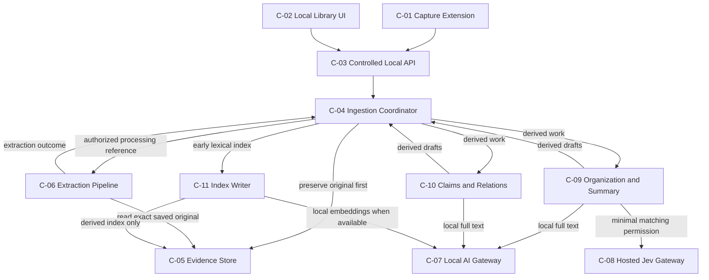
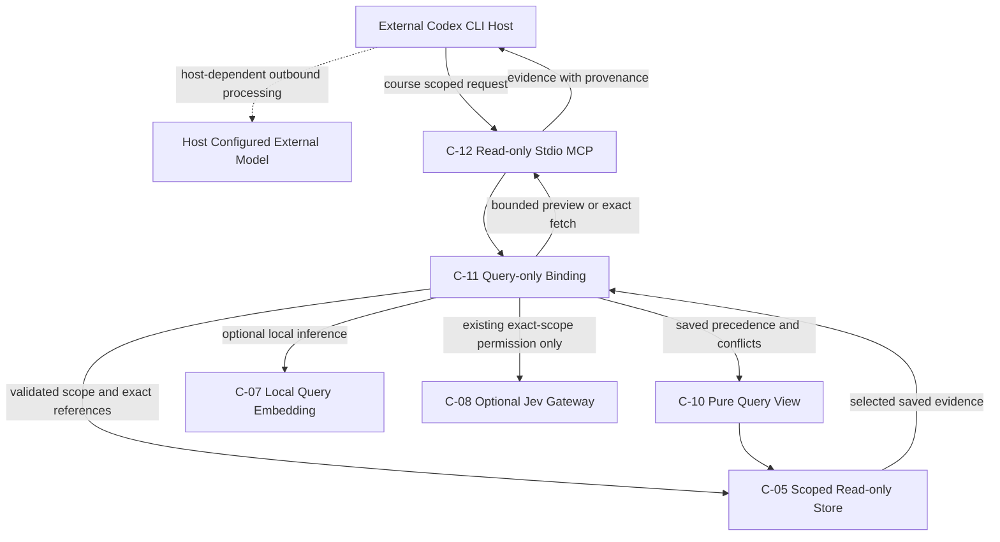

# Course Copilot — Component Dependencies and Data Flow

**Stage:** Inception / Application Design.
**Status:** Proposed design awaiting the separate generated-artifact review. No runtime integration, isolation, model compatibility or test success is asserted.

**Baseline:** [Application Design plan](../plans/application-design-plan.md), [approved requirements](../requirements/requirements.md), [approved stories](../user-stories/stories.md) and [execution plan](../plans/execution-plan.md). Component IDs and the four logical services below follow the stage plan; this is not the later unit decomposition.

## 1. Runtime and dependency direction

The design has one local library runtime with logical modules, a Chrome MV3 extension, a local library UI and a separate local stdio MCP process. S-01 Capture/Ingest, S-02 Processing/Index, S-03 Metadata/Review and S-04 Evidence Query are orchestration responsibilities, not independently hosted microservices.

| ID | Component | Runtime responsibility |
|---|---|---|
| C-01 | Capture Extension | Explicit selected-page and selected-resource capture in the browser; sends permitted content, not browser session credentials. |
| C-02 | Local Library UI | Course browsing, local import, filing review, metadata correction, source/history/conflict inspection and hosted-processing choices. |
| C-03 | Local Library API | Controlled loopback command/query boundary for the locally paired extension and UI. |
| C-04 | Ingestion Coordinator | Durable processing runs, original-first ingestion, item outcomes, bounded work and recovery. |
| C-05 | Evidence Store | SQLite and local originals, source/version identity, separate course memberships, metadata, derived evidence and processing records. Separate read and write ports. |
| C-06 | Extraction Pipeline | Native text, OCR, equation/diagram fidelity and accessible authorized audio/video transcription adapters. |
| C-07 | Local AI Gateway | Local Ollama generation and a local embedding abstraction. The initial generative candidate is gemma3:4b; embedding choice and practical compatibility remain unverified. |
| C-08 | Hosted Jev Gateway | Only disclosed, minimal and explicitly authorized classification/routing/reranking requests. |
| C-09 | Organization and Summary | Correctable filing suggestions and incremental source-linked course/topic/document summaries. |
| C-10 | Claims and Relations | Sourced substantive claims, typed relations and evidence-grounded claim-scoped precedence/conflict views. |
| C-11 | Index and Retrieval | Incremental index writing in the library runtime; a distinct query-only binding for scoped hybrid search and exact evidence fetch. |
| C-12 | Read-only MCP Adapter | Separate stdio process exposing read-only course listing, scoped search/fetch/history/conflicts to Codex CLI. |

The C-05 read and write ports are different capabilities. Likewise, C-11 index maintenance and query execution are different interfaces. A matrix edge describes an allowed dependency in the appropriate composition; it does not grant every caller all capabilities of that component.

Unclassified originals use a temporary IngestionItemRef = {runId, itemKey} in the processing/UI path. An internal ProcessingEvidencePort checks authorization for that run/item before exposing its exact saved original or extraction revision. It is distinct from the course-scoped query read port, is not composed into C-12 and cannot serve as an MCP EvidenceRef. Until an accepted course membership exists, an unclassified item is unavailable to MCP search/fetch/history/conflicts. This permits original-first preservation and uncertain-filing review without inventing a course or exposing unfiled content through an unscoped query.

## 2. Direct dependency matrix

Rows consume the component in a column. An empty dependency is shown as a dash. The matrix records direct edges; transitive dependencies still have to obey the calling runtime's capability limits.

- **H:** controlled loopback HTTP request from the paired extension/UI.
- **C:** internal command/orchestration call in the library runtime.
- **R:** evidence/original/metadata read port.
- **W:** authorized processing/index write port, available only in the library runtime.
- **RW:** separate read and write ports; the MCP composition receives the read subset only.
- **Q:** query-only interface, including pure precedence evaluation; no persisted enrichment or rebuild.
- **L:** optional local model/embedding call; absence returns a disclosed local limitation or fallback.
- **J:** optional hosted request only with preexisting, matching explicit permission for the disclosed payload and operation.

| Consumer / provider | C-01 | C-02 | C-03 | C-04 | C-05 | C-06 | C-07 | C-08 | C-09 | C-10 | C-11 | C-12 |
|---|---|---|---|---|---|---|---|---|---|---|---|---|
| C-01 | - | - | H | - | - | - | - | - | - | - | - | - |
| C-02 | - | - | H | - | - | - | - | - | - | - | - | - |
| C-03 | - | - | - | C | RW | - | - | - | - | - | Q | - |
| C-04 | - | - | - | - | RW | C | - | - | C | C | W | - |
| C-05 | - | - | - | - | - | - | - | - | - | - | - | - |
| C-06 | - | - | - | - | R | - | - | - | - | - | - | - |
| C-07 | - | - | - | - | - | - | - | - | - | - | - | - |
| C-08 | - | - | - | - | - | - | - | - | - | - | - | - |
| C-09 | - | - | - | - | R | - | L | J | - | - | - | - |
| C-10 | - | - | - | - | R | - | L | - | - | - | - | - |
| C-11 | - | - | - | - | RW | - | L | J | - | Q | - | - |
| C-12 | - | - | - | - | R | - | - | - | - | - | Q | - |

C-06, C-09 and C-10 return extraction/enrichment drafts to C-04 for controlled persistence; their C-05 dependency is a read port, not a direct evidence writer. C-11's library-runtime index writer is explicitly separate from its query port.

C-05 depends on SQLite/local files; C-06 on selected local extraction adapters; C-07 on local model/embedding runtimes; C-08 on the hosted Jev endpoint. These are external runtime dependencies, not extra product components or settled tool selections. C-01 may access the page and individually authorized embedded resources through the user's browser context. None of these edges permits forwarding session cookies, passwords or LMS tokens to the local library.

There is deliberately no C-12 → C-03 mutation API, C-12 → C-04 job, or C-12 → C-06 extraction edge. C-11's query binding cannot reach its index writer. C-10's query binding can read/evaluate saved claims and relationships but cannot invoke extraction, models or persistence writes.

## 3. Service orchestration and communication

| Logical service | Entry and participants | Communication and result |
|---|---|---|
| S-01 Capture/Ingest | C-01 or C-02 → C-03 → C-04 → C-05; C-04 schedules S-02. | A validated, authorized local request creates a durable run and preserves an available original before derived work. The caller receives the run/item reference and can inspect progress; a request acknowledgement is not an extraction-complete claim. |
| S-02 Processing/Index | C-04 → C-06, C-09, C-10 and C-11; those modules use C-05 and permitted C-07/C-08 paths. | Bounded durable steps process one selected resource/version at a time and persist explicit outcomes. Derived writes are separate from originals. Failed AI/index steps do not discard the saved source. |
| S-03 Metadata/Review | C-02 → C-03 → C-05, with C-04 scheduling affected follow-up processing when necessary; C-09 supplies saved suggestions. | Course/folder/title/tag/authority corrections, uncertain filing review and hosted-permission choices enter through explicit user commands. They do not mutate original bytes, historical versions or unrelated course memberships. |
| S-04 Evidence Query | C-02 → C-03 → C-11, or external Codex → C-12 → C-11; read through C-05 and C-10 query ports. | Scoped compact search is followed by explicit exact evidence fetch. Local query embeddings and precisely permitted Jev assistance are optional; neither path can create ingestion jobs, consent grants or persisted indexes. |

Inside the library runtime, modules exchange typed requests/results rather than communicating through independently deployed network services. Durable run references and stored progress support inspection/retry without relying on the extension popup or UI remaining open. Progress messages are distinct from each resource's final complete, partial, failed or unsupported outcome.

The stdio MCP process reads the same saved library through read-only SQLite/file access and the query composition. It does not bootstrap the writable library application, run migrations, initialize an index, persist a query cache or start a recovery job. If an index/extraction revision is absent or pending, query responses disclose that limitation and use available local keyword/metadata evidence; they never silently repair it with a write. Exact SQLite flags, process startup and library choices remain later detailed design/verification tasks.

## 4. Original-first save and processing data flow

### Component data-flow diagram

This flowchart shows calls and returned extraction outcomes; the numbered alternative below specifies commit ordering and capability constraints. C-11 here is the writable library-runtime binding. All arrows remain subject to the direct dependency matrix and the separately authorized processing run.

### Numbered text alternative

1. **User → C-01/C-02:** Select an accessible page, external paper/PDF, local file or discovered embedded resource and its intended course when already known. If filing is uncertain, preserve the original under its temporary run/item reference for explicit review; do not invent a course. Discovery alone does not select every link. Canvas, Gradescope, EdStem and ordinary webpages all remain required capture surfaces.
2. **C-01/C-02 → C-03:** Submit the selected content/asset and provenance envelope through the controlled loopback interface. The browser retains its own authenticated session; the library receives permitted content, not copied session credentials. The API validates client authorization, content scope and inputs before allowing a command.
3. **C-03 → C-04 → C-05:** Create the processing run/resource record and preserve the available permitted original/snapshot. Resolve stable SourceId separately from course membership. Same-source changed content receives a new immutable VersionId; unchanged recapture does not create a redundant content version. Its CaptureReceipt records the new capture observation separately, without replacing the version's original capturedAt or citation identity. Similar wording from a different source cannot establish shared identity.
4. **C-04 → C-06 → C-05 processing read port:** Process that exact saved original using the run-authorized ProcessingEvidencePort, including when filing is still pending. Native text is used where present; local OCR supports scans/images; original equations/diagrams remain accessible with reliable derived text/notation where possible; accessible authorized audio/video receives transcription when needed. Locations, omissions and limitations accompany extraction results. C-04 commits the derived extraction and item outcome through the write port, then makes available text eligible for immediate lexical indexing without waiting for AI. Query visibility still requires accepted course membership.
5. **C-04 → C-09/C-10:** Use the extracted saved evidence for correctable filing, incremental course/topic/document summaries, substantive claims and typed relationships. C-09/C-10 return derived drafts to C-04 for authorized persistence. Private full text stays on the local C-07 path. C-08 receives only a disclosed minimal payload whose operation/content match existing permission; denied, unavailable or mismatched permission uses local/manual alternatives.
6. **C-04 → C-11 write port → C-05:** Incrementally enrich only affected derived indexes and records. Lexical indexing does not wait for model/embedding/Jev success. Local vector generation is separate from the initial generative-model choice. Index, summary and claim revisions remain traceable to their supporting source/version and extraction revision; no derived operation rewrites the original.
7. **C-03 → C-01/C-02:** Expose durable progress and final per-resource outcomes. A complete parent page cannot hide an inaccessible child asset. Missing content produces an explicit partial/failed/unsupported result and permitted manual upload/retry path.
8. **Recovery → S-01/S-02:** A user-authorized retry/upload returns through the same source/course and preservation checks. A failed attempt does not overwrite existing versions; unavailable AI does not prevent manual filing or local access to stored originals.

A SourceId is not a course membership. The same underlying source may be associated with separate course documents without merging their filing context. Updating a membership or its metadata must not move another course's item or rewrite shared original content. Detailed canonicalization, hashing, transaction boundaries and recovery algorithms belong to Functional Design.

Re-extraction of an unchanged original is derived processing, not a changed-content recapture. Derived passages use stable PassageIds and immutable extraction-revision references. An old evidence reference is never rebound to a newly generated passage, summary or extraction revision.

Run progress states such as queued, running, succeeded, completed_with_issues, failed and cancelled are distinct from resource completeness. If no usable original was obtained, the stored failed attempt must not invent a successful content version. An AI failure alone does not justify calling a successfully saved original unavailable.

## 5. Progressive read-only MCP data flow

### Query data-flow diagram

The query binding excludes writer/processing ports. Conditional C-07/C-08 edges are optional inference calls, never permission grants or persisted index updates. The external model edge describes the host's separate trust boundary, not a required Course Copilot transmission.

### Numbered text alternative

1. **Codex CLI → C-12 over local stdio:** Discover the read-only tools. Course listing may be unscoped; every search, fetch, history and conflict request carries the intended CourseId.
2. **C-12 → C-11 query port → C-05 read port:** Validate that course scope and resolve available saved material. Search applies required topic, source, date and saved-version filters. Ordinary retrieval favors latest applicable saved evidence; explicit retained-version selection is not historical as-of search.
3. **Optional read-only query enrichment:** C-11 may use C-07 for local query embeddings. C-10's pure/query view applies sourced claim-level applicability/precedence. C-08 may assist routing/reranking only when a previously granted permission already matches the exact disclosed operation and selected minimal content. MCP cannot grant or broaden that permission; otherwise it remains on the local path.
4. **C-11 → C-12 → Codex:** Return bounded ranked previews with stable references, course/title, summary or snippet, source/capture/version information and relevant limitations/conflict indicators. Do not send every full document automatically.
5. **Codex → C-12 → C-11:** Explicitly fetch a selected EvidenceRef. Its CourseId, SourceId, DocumentId, VersionId and optional PassageId are checked against the requested scope and saved records. A derived-text fetch additionally pins the extraction revision; a PassageId remains bound to its immutable ExtractionRevisionId. A reference from another course is rejected without revealing foreign evidence and requires a valid reference in the intended course context.
6. **C-11 → C-05 read port → C-12 → Codex:** Return the actual selected saved passage/full extracted content where available, not a substituted generated summary. Cite the exact source/version and derived extraction revision/location as applicable. Use an original URL when one exists; otherwise use the honest local-import identity. Unknown IDs, unavailable revisions and partial content yield explicit limitations, never fabricated text or silent selection of a newer version.
7. **External Codex/model boundary:** The external host receives the requested returned evidence and may send it to its configured model. The local MCP connection is not a guarantee of on-device inference by that host. This host boundary is distinct from Jev permission; source text remains untrusted evidence and cannot authorize tools, transmissions or permission changes.

Both search and fetch enforce course membership; a correct-looking VersionId alone does not authorize returning another course's item. CapturedAt, known PublishedAt and known EffectiveAt remain distinct. A later capture of an old syllabus cannot outrank an established authoritative update. A deadline change supersedes the applicable claim, not every fact in the older syllabus. If authority/applicability/known dates/supersession cannot establish precedence, the result retains competing evidence. No query claims that unseen LMS updates have been checked or flags ordinary age alone.

## 6. Read/write and trust boundary constraints

| Boundary | Required constraint | Failure behavior |
|---|---|---|
| Authenticated browser → local library | Explicitly selected and accessible content only; no credentials, cookies, LMS tokens or unattended login. | Missing/blocked resources remain visible; permitted manual import can recover. |
| Extension/UI → C-03 loopback | Loopback location alone is insufficient authorization. Pair/validate the intended local clients and their request scope; treat content and uploaded files as untrusted inputs. | Reject unauthorized/invalid commands without creating an apparently successful ingestion. |
| Originals → derived processing | Original bytes and observed versions are immutable; metadata/course membership and derived revisions are separate. | Preserve originals and prior evidence while disclosing failed/pending derived processing. |
| Local modules → C-07 | Local generation/embeddings only; no automatic hosted fallback. Validate model output as untrusted derived data. | Return unavailable/invalid output, retaining manual filing and local keyword/metadata search. |
| Local modules → C-08 | Check explicit matching permission and disclose destination, operation and minimal selected content. No whole-library/original-file or credential upload. | Deny/skip on missing, revoked, mismatched or unavailable permission/service. Core library remains usable. |
| MCP → persistence/query modules | Separate read-only composition and read-only database/file access; no write port, mutation API, ingestion job, index initialization or permission-grant capability. | Report unavailable/pending evidence or index state; no repair-on-read. |
| Returned evidence → external host | Source/version/course provenance and limitations remain visible. Captured instructions remain data; external model handling is a separate boundary. | Do not represent source instructions as user permission or claim host-side privacy guarantees. |
| Runtime evidence → repository/public review | Only permission-cleared/redacted examples and sanitized results; no course secrets or session credentials in documentation/log excerpts. | Keep private evidence local and disclose the verification limitation instead of fabricating a public integration result. |

The intended application boundary is read-only library access, not an unverified claim that a generic Node process is an operating-system sandbox. Construction must verify the actual import/composition graph, database/file modes and before/after library state. Query-side in-memory ranking is allowed; persisted enrichment belongs to the controlled library runtime.

## 7. Later validation obligations and stage limits

- Inspect the dependency/import graph and actual MCP tool set to verify that the query composition cannot acquire writer, migration, ingestion or index-regeneration capabilities.
- Exercise two-course overlapping titles/topics, reused sources with separate memberships, metadata correction and cross-course fetch rejection.
- Verify original preservation, unchanged/changed/failed recapture, source/hash identity, immutable extraction references and exact search-to-fetch round trips. Retain the approved partial property-testing scope for deterministic transformations, serialization and version invariants.
- Exercise actual authorized saves on Canvas, Gradescope and EdStem; ordinary web/PDF/local import; embedded-resource consent/recovery; successful native/OCR/image/math/audio/video paths and honest completeness. An unsupported-format fixture does not replace a successful accessible-format demonstration.
- Verify both lexical and semantic retrieval, every required filter, compact bounded previews, local keyword/manual fallback, unresolved competing evidence and claim-scoped authoritative updates.
- Inspect denied/allowed/revoked/mismatched Jev requests, controlled loopback calls, untrusted source text and AI/network outages. Any actual hosted test still needs permission for its selected payload.
- Demonstrate an actual Codex CLI stdio search-then-fetch; a fixture host or tool listing alone is insufficient. Measure local model/extraction/embedding feasibility rather than assume it.

These are future acceptance obligations, not executed tests. Component dependencies do not assign teammates or finalize units/packages. Application Design still requires generated-artifact approval; Units Generation follows only after that approval. The course milestone stops after approved Units Generation and before Construction.

**Document validation:** Both Mermaid flowcharts passed pre-write simple statement/ID/label/edge-reference checks; they are not claims of rendered or runtime validation. Numbered text alternatives preserve the same boundaries if a renderer is unavailable.

