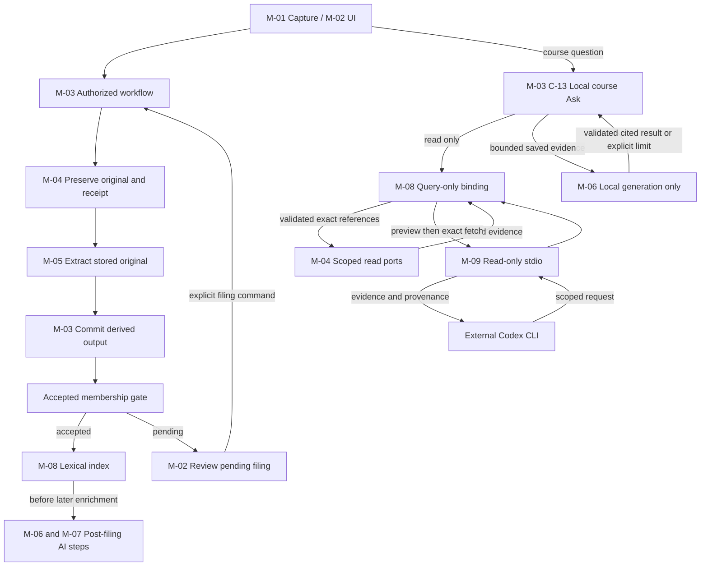

# Course Copilot — Unit of Work Dependencies

> **Approved corrective Inception artifacts - November 23, 2026:** [Lawrence's maintainer approval](https://github.com/lawrencegranda/INFO-5940-project/pull/8#issuecomment-7115984386) at 2026-11-23T22:37:29Z covers the revised artifacts through Units Generation, including Ask/local MCP and documented Jev/media deferrals. Historical approvals remain recorded separately. STOP before Construction.

**Stage:** Inception / Units Generation / Part 2: Generation.
**Status:** Corrective dependency artifacts approved by Lawrence at 2026-11-23T22:37:29Z as part of Inception through Units Generation. November 20 approvals remain historical baseline records. This is a dependency design, not implemented or tested runtime behavior.

**Inputs:** [Unit plan](../plans/unit-of-work-plan.md), [component dependencies](component-dependency.md), [component methods](component-methods.md) and [stories](../user-stories/stories.md).

**Delivery phases:** The [MVP scope and deferred-feature catalog](../requirements/mvp-scope.md) distinguishes current acceptance from retained post-MVP work. All 26 story IDs, 16 FRs, seven NFRs, 13 component IDs, five services and U-01/nine modules remain in the planning catalog. A retained future contract is not a current-MVP dependency or acceptance blocker.

## 1. Unit-level dependency matrix

U-01: Local Course Copilot is the complete local application bundle. Chrome extension, UI, Node library and stdio MCP entry points are different runtimes inside the same delivery unit, not independent hosted services.

| Consumer / provider | U-01 |
|---|---|
| U-01 | - |

There are **no cross-unit dependencies**. The diagonal dash means no runtime self-dependency at unit level; it does not remove internal module relationships or external tool/model dependencies. All US-01–US-26, FR-01–FR-16 and NFR-01–NFR-07 remain U-01 catalog responsibilities, with delivery phase recorded separately.

## 2. Internal module and capability matrix

| Module | Components in current draft | Responsibility |
|---|---|---|
| M-01 Capture | C-01 | Explicit Chrome page and individually selected resource capture. |
| M-02 Library UI | C-02 | Import, filing/review, browsing, evidence/history/conflict inspection and per-course Ask navigation state. |
| M-03 API and Workflow | C-03/C-04/C-13 | Controlled loopback commands/ingestion plus separately composed course Ask using read/query/local-generation capabilities only. |
| M-04 Evidence | C-05 | Immutable originals/versions, memberships, revisions, receipts and separated ports. |
| M-05 Extraction | C-06 | MVP native HTML/text/PDF drafts and original viewing; post-MVP OCR, advanced math/diagram recognition and media transcription. |
| M-06 Model Gateways | C-07/C-08 | MVP local generation/embeddings; C-08 hosted Jev and consent dependencies are retained post-MVP. |
| M-07 Knowledge | C-09/C-10 | Filing/summary/fact/relation drafts and pure precedence/conflict views. |
| M-08 Index and Query | C-11 | Incremental index writer and separately composed scoped read-only query. |
| M-09 MCP | C-12 | Separate local stdio adapter exposing six read-only business tools. |

Rows consume the module in a column. These are direct capability dependencies, aggregated from the current C-01–C-13 matrix. A slash joins separate bindings, not a combined authority granted to every caller.

- **H:** controlled loopback request by the locally paired extension/UI.
- **C:** authorized library-runtime processing/orchestration call.
- **R:** current-course-scoped evidence/metadata read.
- **P:** internal ProcessingEvidencePort read authorized for a selected run/item, including pre-filing originals.
- **V (post-MVP):** restricted PermissionReadPort validation of an already scoped, preexisting hosted grant; no enumeration or grant mutation.
- **W:** controlled persistence/index write port in the library runtime only.
- **Q:** query/pure-view binding; no enrichment, job creation or writes.
- **L:** current-MVP local model call. **J (post-MVP):** explicitly permitted minimal Jev request; no J or V edge is composed in the current MVP.

| Consumer / provider | M-01 | M-02 | M-03 | M-04 | M-05 | M-06 | M-07 | M-08 | M-09 |
|---|---|---|---|---|---|---|---|---|---|
| M-01 | - | - | H | - | - | - | - | - | - |
| M-02 | - | - | H | - | - | - | - | - | - |
| M-03 | - | - | - | R/P/W | C | L | C | Q/W | - |
| M-04 | - | - | - | - | - | - | - | - | - |
| M-05 | - | - | - | P | - | - | - | - | - |
| M-06 | - | - | - | V (post-MVP) | - | - | - | - | - |
| M-07 | - | - | - | R/P | - | L; J post-MVP | - | - | - |
| M-08 | - | - | - | R/W | - | L; J post-MVP | Q | - | - |
| M-09 | - | - | - | R | - | - | - | Q | - |

The M-03 row aggregates distinct compositions: C-04 owns processing/writes, while C-13 receives only scoped M-04 reads, M-08 query and M-06 local generation. The aggregate R/P/W and Q/W cells never give C-13 processing/write ports; its L edge is local generation only, not Jev.

M-05 and M-07 return drafts to M-03; they do not acquire direct original/derived-write authority. M-03 persists valid drafts through M-04 and dispatches index changes through M-08's writer. M-06 has a restricted permission-validation store edge only in the retained post-MVP hosted composition; the MVP has no C-08/hosted-permission runtime dependency. Local generation/embeddings do not read the database independently.

M-08 → M-07 means only the pure claim/precedence query view, not the latter's model-enrichment composition. M-09 receives only M-04's scoped read ports and M-08's query binding. It cannot obtain P, W or the M-03 API/worker entry points through an indirect import.

## 3. Runtime composition and data flow

The diagram shows principal data handoffs rather than an executable schedule or a replacement for the capability matrix. Returning a result and the filing/retry workflow can form runtime feedback loops. The unit matrix does not assert that processing and read responses form a one-way DAG; repeated module labels represent distinct port compositions.

### Text alternative and ordering constraints

1. M-01/M-02 submit an explicit selected capture/import to controlled M-03. Browser-authorized acquisition stays in the browser; credentials, cookies and LMS tokens are not exported.
2. M-03/M-04 preserve the permitted original and its source/hash identity before extraction. Changed content creates a preserved version; unchanged recapture adds a CaptureReceipt observation without replacing the original version's capturedAt or creating a redundant content version.
3. M-05 reads that exact saved original through the authorized ProcessingEvidencePort and returns extraction drafts. M-03 commits an immutable extraction revision and stable passage identities through M-04; re-extraction never rewrites originals or rebinds old references. Deferred OCR/transcription will obey the same invariant.
4. A pending item remains accessible only in its authorized run/UI context under IngestionItemRef. Initial M-07/M-06 filing suggestions may run in that private context before membership, using the local model or manual filing. Jev-backed suggestions and matching hosted permission are retained post-MVP. Accepted membership, established manually or under the agreed validated auto-filing policy, must exist before course-index publication or MCP evidence access. An unclassified item never receives a fabricated course.
5. After that gate, M-08 publishes available lexical text without waiting for summaries or embeddings. Jev is not part of current-MVP indexing or retrieval. M-06/M-07 perform post-filing enrichment of affected material and return validated drafts for controlled persistence; semantic-index writes remain a separate M-08 capability. Required AI/semantic acceptance is still verified later rather than inferred from fallback success.
6. Codex CLI calls M-09 over stdio, then M-08's query binding reads M-04 and M-07's pure view. Only course listing is unscoped; search, exact fetch, history and conflicts validate current membership and all source/document/version/extraction/passage relationships.
7. M-02 submits a course-bound question through controlled M-03 to C-13. C-13 searches/fetches bounded evidence through M-08/M-04, calls only local M-06 generation and validates returned references against that evidence. Empty/uncertain/conflicting evidence and model failures remain visible; no source-driven instructions can grant actions. M-02 retains draft/result/error per course during navigation and does not display an old in-flight response in another course.
8. Search returns bounded previews; explicit fetch returns actual selected saved text with exact provenance and disclosed omissions. Old references never redirect silently to latest. Missing/out-of-scope evidence is reported safely; no query initiates repair, migration, index regeneration, summary creation or permission grants.

The query composition opens read-only database/file/query access. Shared DTOs/helpers under the approved future root src/ layout cannot import writable startup, migrations, processing ports or credential configuration into M-09. An absent/incompatible library or missing projection yields a diagnostic/fallback and requires a separate authorized library action.

## 4. External dependencies and trust boundaries

These are external dependencies of U-01, not additional units. Tool availability, installation and compatibility remain unverified until later authorized work.

| Dependency | Consuming area and boundary | Required behavior |
|---|---|---|
| Chrome MV3 and authorized sites/files | M-01; M-02 local uploads | User-triggered capture on Canvas, Gradescope, EdStem, ordinary web/papers/PDFs and selected embeds; no unattended login or session export. |
| Local TypeScript/Node runtime | M-03 library and separate M-09 process | One local installation/verification bundle, with distinct command and read-only startup compositions; loopback reachability alone is insufficient authorization. |
| SQLite/FTS5 and local files | M-04; M-08 index/query ports | Original-preserving persistence, current memberships and derived projections; MCP read-only startup cannot create/migrate storage or write caches. |
| Local extraction tools/codecs | M-05 | MVP native HTML/text/PDF extraction, original viewing and honest unsupported/partial outcomes. OCR, advanced equation/diagram recognition and audio/video adapters are post-MVP; their later tool choices remain open. |
| Ollama and local embedding capability | M-06 via M-07/M-08 and M-03/C-13 Ask | gemma3:4b is the first generative candidate, not an embedding-compatibility promise. Ask generation remains local; no remote ChatGPT/tunnel integration is added. Measure both capabilities; no automatic hosted fallback or paid-call dependency for core access. |
| Codex CLI and its configured model | M-09 local stdio; host receives selected evidence | Actual search-then-fetch must be demonstrated later. Local MCP transport/storage does not guarantee host-side on-device inference; external model processing is a separate disclosure boundary. |
| Hosted Jev — post-MVP | M-06/C-08, used by M-07/M-08 | Retained future contract; not installed, configured or wired for MVP. Later requests use only disclosed matching minimal classification/routing/reranking payloads under active explicit permission. Denied/revoked/mismatched/unavailable requests use local/manual fallback; no full originals, secret upload or MCP-created consent. |

Captured text, OCR, transcripts and provider output remain untrusted data. They cannot grant tools, broaden course scope, mutate consent or establish source authority through an instruction. The Jev permission boundary does not authorize every possible external destination.

## 5. Integration order and parallel work

1. Agree shared identifiers/results, immutable version/extraction/capture-receipt semantics and independent read/write/processing ports. M-03/M-04 establish the foundation; source identity and course membership remain separate.
2. Integrate an early native-text/PDF slice: capture/import → saved original → extraction → derived commit → accepted membership → lexical retrieval → local Ask and actual Codex search/fetch. Begin native-text/PDF and authorized three-LMS checks early after Construction authorization. Schedule deferred media/Jev probes in later work.
3. Complete current-MVP source/native-format adapters, per-item status, original viewing and manual recovery. M-01/M-02/M-05 may proceed in parallel against agreed contracts and labeled fixtures, while M-03/M-04 remain the coordinated evidence boundary.
4. Add M-06/M-07 correctable filing, incremental source-linked course/topic/document summaries and substantive claims/relations; M-08 adds required hybrid retrieval/filter behavior. Vector/AI failure does not block existing originals or lexical access.
5. Integrate claim-scoped authoritative updates, unresolved conflicts, exact history/revision access, read-only startup, privacy/failure paths and the whole local product demonstration, including grounded Ask, citation validation, per-course navigation continuity and in-flight response isolation.

Parallel module work is not parallel unapproved Inception editing or independent unit acceptance. One workflow driver serializes audit/state; teammates claim module implementation responsibilities later. The proposed leads are Safi M-01/M-09, Iris M-02, Lawrence M-03/M-04, Chloe M-05/M-07 and Xiaolong M-06/M-08; individual acceptance remains pending. No effort estimate or delivery guarantee is assigned here. Persisted index/summary/claim repair is authorized write-side work even when triggered by a user-visible query limitation.

## 6. Unit acceptance and stage boundary

- Current-MVP U-01 acceptance covers the MVP portions of the retained story/requirement catalog and integrated evidence, not merely isolated fixture modules. Deferred story portions retain separate post-MVP acceptance. The companion story map assigns each of the 26 stories once to U-01 with primary/supporting module responsibility.
- Demonstrate successful current-MVP native HTML/text/PDF capture and extraction across the named sources, original viewing and honest unsupported status. Actual authenticated-site/Codex integration remains required. Post-MVP OCR/media successes do not block MVP acceptance.
- Verify two-course scoping, separate memberships for reused sources, immutable originals and extraction references, changed/unchanged/failed recapture, metadata correction and exact search-to-fetch round trips. Retain partial property testing for pure transformations, serialization and version invariants.
- Verify claim-level supersession, later old-syllabus recapture and unaffected syllabus facts; retain competing evidence when precedence is unknown. Capture time alone is not authority, ordinary age is not a conflict and saved evidence does not prove unseen LMS freshness.
- Verify controlled loopback requests, untrusted source text, model/embedding outages and offline/manual fallback in the MVP. Denied/allowed/revoked Jev scope is a retained post-MVP verification obligation. Keep private course material and secrets out of published evidence.
- Verify local Ask using matching source/version/passage citations, empty evidence, conflicting evidence, invalid-model output, per-course draft/result retention and in-flight course switches. Missing models must disclose retrieval-only behavior; Ask never mutates library evidence or grants hosted consent.
- These are planned runtime acceptance obligations. The corrected dependency artifact has separate maintainer approval in [Lawrence's maintainer approval](https://github.com/lawrencegranda/INFO-5940-project/pull/8#issuecomment-7115984386). STOP at the Inception milestone before Construction. No application code, runtime directories or tests are generated by this document.

**Document validation:** The 9-by-9 module matrix and 1-by-1 unit matrix were checked before writing. Mermaid statement syntax, safe unique IDs, labels and edge endpoints were structurally validated; the text alternative remains available. No rendered-diagram or runtime-validation result is claimed.
