# Course Copilot — Execution Plan

**Stage:** Inception / Workflow Planning
**Status:** Approved on 2026-11-20T03:18:17Z.
**Baseline:** Requirements approved at `485c52531f004b1e184fb595abe771cfbcd17003`; 25 stories and P-01 approved on 2026-11-20T03:04:34Z.
**Review:** [Draft PR #6](https://github.com/lawrencegranda/INFO-5940-project/pull/6).

**Branch:** `inception/03-workflow-planning`, based on approved User Stories head `b185e9d421e8e44c165d78ebe9e152fbbed65b82`.
**Integration:** `candidate/course-copilot` in the team repository. This stage depends on [PR #5](https://github.com/lawrencegranda/INFO-5940-project/pull/5), ready for maintainer integration. Merge #5 first, then this stage; do not merge a cumulative stage diff out of order.

## 1. Inputs and preserved scope

Inputs: [requirements](../requirements/requirements.md), [decision register](../requirements/decision-register.md), [stories](../user-stories/stories.md), [persona](../user-stories/personas.md), [state](../../aidlc-state.md) and [audit](../../audit.md). The 43 requirement answers and eight clarifications are resolved; no replacement product questionnaire is introduced.

Retain a private multi-course library: Chrome MV3 capture, TypeScript/Node local runtime, SQLite/FTS5 plus local originals, source-linked extraction/summaries, hybrid keyword/vector retrieval and progressive read-only local MCP first demonstrated with Codex CLI. Ollama `gemma3:4b` is the first generative-model candidate, subject to laptop measurement. Jev receives only specifically disclosed minimal content after explicit opt-in. Manual filing and local keyword/metadata search remain available without Jev or AI.

All approved sources/formats remain required: Canvas, Gradescope, EdStem, ordinary web/papers/PDFs/local imports; native text, scan/image OCR, preserved math/diagrams with reliable derived text, and accessible authorized audio/video transcription. Inaccessible content must have explicit partial/failed/unsupported status and manual recovery. A failure-status test does not replace a successful accessible-format demonstration.

## 2. Detailed scope and impact analysis

**Greenfield:** No application code, deployed system or existing package graph is present. Brownfield transformation scope, related-component migration, reverse-engineering artifacts and package update analysis are N/A.

| Impact | Assessment |
|---|---|
| User-facing | New save/import and embedded-resource selection, uncertain filing review, editable metadata, source/history and conflict inspection. No built-in chatbot. |
| Structural | New extension, local library runtime, extraction/index workers and read-only MCP boundary. These are capability areas; Application Design determines components and contracts. |
| Data model | Courses/topics, sources, immutable document versions/originals, passages, claims, typed relationships and ingestion runs. Editable metadata stays separate from originals. |
| API | Extension-to-local ingestion/library APIs, extraction/model adapters, compact MCP search and exact evidence fetch. Exact signatures/tool names belong to Application Design. |
| NFR | Local persistence, provenance, privacy/permission boundaries, controlled loopback access, completeness, recovery, repeatable evaluation and measured latency/cost. |
| Infrastructure | Laptop-local processes, SQLite/files, tool/model installations and start/stop instructions. No cloud hosting, hosted MCP, multi-user accounts or cloud IaC. |
| Operations | Visible processing/error state and repeatable local setup/demo instructions. Production operations remains a placeholder. |

**Risk: HIGH; testing complexity: high; rollback complexity: moderate.** Authenticated SPAs, multimodal extraction and authority/version correctness create integration uncertainty. This is a new student demo, not a production-critical migration. Branch changes are reversible; future schema/index changes require original-preserving migration, backup/recovery and rebuild checks.

| Risk | Required later response and evidence — none run yet |
|---|---|
| LMS and embeds | User-triggered authorized capture without credentials/cookies/tokens; actual save on each LMS, ordinary web/PDF/local import and accessible embedded asset; restricted-resource case and manual recovery. |
| OCR/media/math | Native extraction where available, local OCR/transcription adapters, preserved originals/locations and per-item status; successful text/scan/image/math/audio/video examples plus fidelity and failure inspection. Exact tools await later technology decisions. |
| Local AI and embeddings | Benchmark gemma3:4b and select a local embedding path; record machine/input, latency, memory and output quality. Prove lexical and paraphrase retrieval. No model compatibility or speed claim until measured. |
| Source/authority errors | Deterministic source/hash identity, immutable versions and evidence-based claim-scoped precedence. Test explicit deadline change, later old-syllabus recapture, unaffected syllabus facts and unresolved competing evidence. A changed deadline cannot supersede every syllabus fact. |
| Privacy/trust | Controlled loopback ingestion, read-only MCP, untrusted source instructions and minimal Jev opt-in. Test denied opt-in, unauthorized calls and read-only tools. External Codex/model processing is a separate trust boundary: local MCP does not guarantee that a host keeps received passages local. |
| Scope/schedule | Agree contracts before parallel work; run an early integrated slice and high-risk probes after Construction authorization. If breadth is infeasible, request an explicit scope decision; do not silently drop sources/formats. |

## 3. Stage selection and adaptive detail

There are **14 stage slots**: seven Inception, six Construction, one Operations. **12 are selected for execution**, including the four completed stages through Workflow Planning. Reverse Engineering is skipped; Operations is a placeholder. Future Construction stages repeat as applicable to the units established later; selection is not current authorization.

| Stage | Decision/status | Rationale and detail |
|---|---|---|
| Workspace Detection | COMPLETED | Greenfield workspace and rules verified. |
| Reverse Engineering | SKIP | No existing application to analyze. |
| Requirements Analysis | COMPLETED | Approved 15 FRs, seven NFRs and reconciled decisions. |
| User Stories | COMPLETED | Separately approved plan, 25 stories and P-01 persona. |
| Workflow Planning | COMPLETED | This execution plan, sequence, evidence and gates. |
| Application Design | EXECUTE next after approval | Substantial component/interface/orchestration and trust/data-boundary detail; no detailed algorithms yet. |
| Units Generation | EXECUTE after design approval | Substantial unit boundaries/dependencies, code organization and complete story ownership. |
| Functional Design | EXECUTE later; DEFERRED | Per-unit identity/version/claim/precedence, extraction states and retrieval logic. |
| NFR Requirements | EXECUTE later; DEFERRED | Performance, privacy, recovery and concrete tools/models/stack decisions informed by actual measurements. |
| NFR Design | EXECUTE later; DEFERRED | Local concurrency, safe persistence, failure/permission boundaries and partial property testing. |
| Infrastructure Design | EXECUTE later; DEFERRED | Concise laptop process/dependency/path/loopback map for Chrome, Node, SQLite/files, Ollama, extraction tools and Codex. Local execution still needs a runtime map. |
| Code Generation | EXECUTE later; DEFERRED | Always required for the requested prototype, after course checkpoint and later approvals; application code at repository root/packages. |
| Build and Test | EXECUTE later; DEFERRED | Always required; automated fixtures/properties, actual source/client integration and manual local demo. |
| Operations | PLACEHOLDER | Production hosting/operations excluded; local setup/demo instructions remain required. |

Every executed stage creates **all artifacts defined by its rule file**; adaptive depth changes detail, not artifact completeness. Security/Resiliency Baseline extensions remain disabled; approved core privacy/recovery requirements still apply. Partial property-based testing remains enabled for pure transformations, serialization round trips and version invariants.

## 4. Workflow visualization

Green: completed/current required or always-selected stages. Orange: conditional stages selected. Gray: skipped/placeholder. Purple: boundaries. Red: current milestone stop. Labels, not colors, establish actual status; future Code Generation and Build/Test remain deferred. The dashed resumption edge is conditional future work, not permission to enter Construction.

```mermaid
flowchart TD
    Start(["Course Copilot request"])
    subgraph INCEPTION["INCEPTION"]
        WD["Workspace Detection: COMPLETED"]
        RE["Reverse Engineering: SKIP"]
        RA["Requirements Analysis: COMPLETED"]
        US["User Stories: COMPLETED"]
        WP["Workflow Planning: COMPLETED"]
        AD["Application Design: EXECUTE after approval"]
        UG["Units Generation: EXECUTE after design approval"]
    end
    Stop(["STOP before Construction: Inception milestone"])
    Resume(["Later project selection and Construction authorization"])
    subgraph CONSTRUCTION["CONSTRUCTION - FUTURE ONLY"]
        FD["Functional Design: EXECUTE later"]
        NR["NFR Requirements: EXECUTE later"]
        ND["NFR Design: EXECUTE later"]
        ID["Infrastructure Design: EXECUTE later"]
        CG["Code Generation: EXECUTE later"]
        BT["Build and Test: EXECUTE later"]
    end
    subgraph OPERATIONS["OPERATIONS"]
        OPS["Operations: PLACEHOLDER"]
    end
    End(["Verified local demo"])
    Start --> WD --> RE --> RA --> US --> WP --> AD --> UG --> Stop
    Stop -.-> Resume
    Resume --> FD --> NR --> ND --> ID --> CG --> BT --> End
    BT -.-> OPS
    style Start fill:#CE93D8,stroke:#6A1B9A,stroke-width:3px,color:#000
    style End fill:#CE93D8,stroke:#6A1B9A,stroke-width:3px,color:#000
    style Resume fill:#CE93D8,stroke:#6A1B9A,stroke-width:3px,color:#000
    style Stop fill:#FFCDD2,stroke:#B71C1C,stroke-width:3px,color:#000
    style WD fill:#4CAF50,stroke:#1B5E20,stroke-width:3px,color:#fff
    style RA fill:#4CAF50,stroke:#1B5E20,stroke-width:3px,color:#fff
    style US fill:#4CAF50,stroke:#1B5E20,stroke-width:3px,color:#fff
    style WP fill:#4CAF50,stroke:#1B5E20,stroke-width:3px,color:#fff
    style RE fill:#BDBDBD,stroke:#424242,stroke-width:2px,stroke-dasharray:5 5,color:#000
    style OPS fill:#BDBDBD,stroke:#424242,stroke-width:2px,stroke-dasharray:5 5,color:#000
    style AD fill:#FFA726,stroke:#E65100,stroke-width:3px,stroke-dasharray:5 5,color:#000
    style UG fill:#FFA726,stroke:#E65100,stroke-width:3px,stroke-dasharray:5 5,color:#000
    style FD fill:#FFA726,stroke:#E65100,stroke-width:3px,stroke-dasharray:5 5,color:#000
    style NR fill:#FFA726,stroke:#E65100,stroke-width:3px,stroke-dasharray:5 5,color:#000
    style ND fill:#FFA726,stroke:#E65100,stroke-width:3px,stroke-dasharray:5 5,color:#000
    style ID fill:#FFA726,stroke:#E65100,stroke-width:3px,stroke-dasharray:5 5,color:#000
    style CG fill:#4CAF50,stroke:#1B5E20,stroke-width:3px,color:#fff
    style BT fill:#4CAF50,stroke:#1B5E20,stroke-width:3px,color:#fff
    style INCEPTION fill:#BBDEFB
    style CONSTRUCTION fill:#C8E6C9
    style OPERATIONS fill:#FFF59D
    linkStyle default stroke:#333,stroke-width:2px
```

**Text alternative:** Workspace complete → Reverse Engineering skipped → Requirements approved → User Stories approved → review execution plan → Application Design plan/decisions, artifacts and explicit approval → Units Generation plan approval, generation and artifact approval → **STOP before Construction for November 24**. After project selection and later authorization, each unit follows Functional Design → NFR Requirements → NFR Design → local Infrastructure Design → Code Generation → Build and Test, with each required review. Integrate units and demonstrate the local product; Operations remains a placeholder.

## 5. Remaining Inception deliverables and gates

| Stage | All mandatory deliverables | Gate |
|---|---|---|
| Application Design | `plans/application-design-plan.md`; `application-design/components.md`, `component-methods.md`, `services.md`, `component-dependency.md`, consolidated `application-design.md` (paths under `inception/`). | Resolve context-relevant design questions using existing decisions where sufficient; execute the agreed plan; obtain explicit artifact approval before Units Generation. |
| Units Generation | `plans/unit-of-work-plan.md`; `application-design/unit-of-work.md`, `unit-of-work-dependency.md`, `unit-of-work-story-map.md`. Include greenfield code organization. | Separate plan and generated-artifact approvals; assign all 25 stories and NFR obligations; verify boundaries/dependencies; STOP at Inception after approval. |

Driver remains `xiaolonglin1124-bit`. PR #5 is the completed prior gate awaiting maintainer integration; this stage is the sole active Draft gate from the same driver and discloses that dependency. INFO5940-06 prohibits parallel Inception edits by **another teammate**. Preparation here follows completion and explicit approval of the prior gate, not an unapproved parallel gate. Before every stage fetch/status, list open PRs and check conversation, review and inline feedback. If another teammate has an active Inception PR, stop parallel documentation edits and reconcile through that workflow.

Integrate #5 first, then later stage PRs in order into `candidate/course-copilot`, preserving a single audit/state history; never hand-merge those files. If maintainers squash/rebase the prior PR, refresh the later branch from the integrated candidate through the single-writer workflow and reverify the audit prefix before merging it. Keep Marketing isolated; only the selected coherent final candidate goes to `main`. This plan does not select the project for the whole team or assign teammates without agreement.

## 6. Future implementation order and coordination

This proposed capability sequence informs later unit decomposition; it is **not generated units, fixed packages or team assignments**. Brownfield package-change sequencing is N/A.

1. Establish shared source/version/status/citation contracts and local persistence. Verify deterministic recapture and original preservation before dependent indexing or AI claims.
2. Deliver a text/PDF vertical slice: explicit capture/import → preserved source → local keyword search → progressive read-only MCP. Begin three-LMS, OCR/media/math feasibility checks early in this window after Construction authorization.
3. Complete all source/format adapters with honest per-item status and manual recovery. Add correctable filing and source-linked incremental course/topic/document summaries; AI availability cannot block originals or lexical search.
4. Add claim-scoped updates/supersession/conflicts and required hybrid retrieval with all metadata/version filters. Similarity may suggest relations but cannot establish identity or authority.
5. Complete library/history/conflict views and actual Codex CLI integration; run both principal demos and the full source/format/failure matrix. Jev remains behind disclosed opt-in.

After approved contracts/unit boundaries, adapters and browsing UI may proceed in parallel with isolated fixtures. Persistence/version semantics precede dependent claims and retrieval. Feature branches own application files per approved unit; one workflow driver serializes audit/state. Check contracts at integration; keep derived indexes rebuildable and originals preserved. No Construction work is executed by this plan.

## 7. Acceptance and evidence plan

All rows below are **specified, not run**. The approved stories remain the detailed acceptance source.

| Coverage | Stories | Required future evidence |
|---|---|---|
| Sources, embeds and consent/recovery | US-01–US-03, US-23–US-24 | Fixtures plus actual authorized saves on each LMS; ordinary web/PDF/local and embedded resource flows; record exact surface and limitations. |
| Native/OCR/math/media | US-04–US-07, US-23 | Successful accessible examples for every required format, original/location fidelity and all status/manual recovery cases. |
| Multi-course and organization | US-08–US-11 | Course isolation, uncertain suggestion review, metadata correction preserving originals, incremental course/topic/document summaries. |
| Provenance, versions, typed links, history | US-12–US-15 | Same-source/same-hash idempotence, changed-hash preserved version, similarity-only suggestions, exact citation/history round trips. |
| Updates and unresolved conflicts | US-16–US-18 | Nov 20 syllabus → explicit Nov 22 announcement; later old-syllabus recapture cannot win; unaffected facts and unresolved competing evidence remain visible. No age-only alarm. |
| Hybrid/progressive retrieval and Codex | US-19–US-22 | Lexical/paraphrase queries with every filter; compact search then exact fetch; actual Codex CLI connection/use and read-only tool behavior. |
| Privacy, outage and laptop feasibility | US-23–US-25 | Denied/disabled/unavailable Jev; AI/network-disabled manual filing/local search; untrusted input, loopback controls, extraction recovery; measured local resource/latency/cost log. |

Use approved Vitest fixtures/manual E2E and partial property tests for pure transformations, round trips and version invariants. Carry FR-01–FR-15 and NFR-01–NFR-07 into unit/test mappings. A fixture/screenshot does not prove a live LMS integration; a tool listing alone does not prove a successful Codex search/fetch. Keep private course content and credentials out of published evidence.

## 8. Timeline and success criteria

Dates use **America/New_York**. Windows are proposals dependent on reviews/project selection, not measured effort or guaranteed completion dates.

| Window | Proposed outcome |
|---|---|
| November 19–20 | User Stories handoff and execution-plan review. |
| November 20–22 | Application Design decisions, full artifacts and approval. |
| November 22–24 | Unit plan approval, all three unit artifacts, mappings and final Inception review. |
| November 24, 2026, 11:59 PM EST | Coherent Inception submission through Units Generation; STOP before Construction (INFO5940-02). |
| After checkpoint/selection, through December 16 | If authorized: per-unit design/implementation, early feasibility measurements, integrated local prototype and final demo. Reassess scope risk from evidence. |

**Inception milestone success:** Approved execution plan, complete approved design/unit artifacts, deliberate gate answers, coherent audit/state, no application code or secrets in documentation.

**Later product success:** Team-laptop demonstration of (1) scoped conceptual search/fetch in Codex and (2) evidence-grounded deadline changes/conflicts/history, with required source/format paths and local fallback verified. No live freshness, perfect contradiction detection or untested model-speed promise is added.

## 9. Workflow Planning checklist

- [x] Load approved context, state, stage/course rules and existing decisions.
- [x] Fetch/status, inspect open PRs and prior-stage feedback.
- [x] Record generated-artifact approval before completing User Stories.
- [x] Analyze impacts, risks, local boundaries and stage selection/depth.
- [x] Prepare validated Mermaid structure and text alternative.
- [x] Define sequence, complete artifacts, evidence, timeline and milestone stop.
- [x] Independently review this concrete plan and resolve findings.
- [x] Publish/present plan and check stage-PR feedback before approval.
- [x] Record explicit execution-plan approval, complete stage and start Application Design.

## 10. Execution-plan approval

### Q1 — Review this execution plan

A) **Approve this execution plan and continue to Application Design.** Retain selected stages, full scope, local runtime, evidence obligations and the stop after Units Generation. Later design/units approvals and Construction authorization remain separate.

B) **Request changes before continuing.** Specify the stages, sequence, safeguards or evidence to revise. You may add the skipped Reverse Engineering stage if previously unidentified application code exists.

C) **Other.** Describe the requested outcome after the answer tag.

[Answer]: A

**Historical approval response (English translation):** A: Approve the execution plan and proceed to Application Design. The original raw response is preserved in the [audit](../../audit.md#workflow-planning--explicit-execution-plan-approval). This translation records the historical choice; it is not a new approval. The [current review hold](../../aidlc-state.md#current-checkpoint-and-handoff) remains in force.

This explicit approval completes Workflow Planning and authorizes Application Design. Later artifact/units approvals and Construction authorization remain separate.

## 11. Extension compliance

| Rule | Status at current boundary | Evidence |
|---|---|---|
| INFO5940-01 | Compliant | Follow Workflow Planning; record prior approval/current work in append-only audit/state. |
| INFO5940-02 | Compliant | All remaining Inception artifacts listed; explicit stop; Construction only planned. |
| INFO5940-03 | Compliant at review boundary | All prior answers complete; execution-plan approval is explicitly recorded before Application Design. |
| INFO5940-04 | Compliant | Local demo; named Ollama candidate; progressive read-only Codex MCP; Jev opt-in/fallback. |
| INFO5940-05 | Compliant | Documentation only; no application code or credentials. |
| INFO5940-06 | Compliant with disclosed dependency | Same driver, prior gate approved/ready, sole active Draft gate, ordered integration, no competing teammate workflow or manual audit/state merge. |
| PBT-02, PBT-03, PBT-07, PBT-08, PBT-09 | Implementation deferred; obligations retained | Pure-transform/round-trip/version tests planned; no executable test result invented. |

Runtime feasibility remains unverified. Workflow Planning is complete. Independent review, publication in PR #6, available feedback checks and explicit Q1 approval are recorded.
