# Course Copilot — Execution Plan

> **Current corrective draft - November 23, 2026:** The current MVP includes local Ask and read-only local MCP with their local evidence-library foundations. Jev and advanced media processing remain planned for post-MVP work. Historical approvals cover the earlier baseline; current revised artifact approval is pending. STOP before Construction.

**Stage:** Inception / Workflow Planning
**Status:** Historical approval recorded on 2026-11-20T03:18:17Z; current corrective revision pending team artifact approval.
**Historical baseline:** Requirements approved at `485c52531f004b1e184fb595abe771cfbcd17003`; 25 stories and P-01 approved on 2026-11-20T03:04:34Z.
**Review:** [Draft PR #6](https://github.com/lawrencegranda/INFO-5940-project/pull/6).

**Historical stage branch:** `inception/03-workflow-planning`, based on approved User Stories head `b185e9d421e8e44c165d78ebe9e152fbbed65b82`.
**Current corrective branch:** `inception/05-units-generation` / PR #8. **Integration target:** `candidate/course-copilot` in the team repository, through the ordered #5 -> #6 -> #7 -> #8 chain after actual revised approval. Do not merge a cumulative stage diff out of order.

**Delivery phases:** The [MVP scope and deferred-feature catalog](../requirements/mvp-scope.md) distinguishes current acceptance from retained post-MVP work. All 26 story IDs, 16 FRs, seven NFRs, 13 component IDs, five services and U-01/nine modules remain in the planning catalog. A retained future contract is not a current-MVP dependency or acceptance blocker.

## 1. Inputs and preserved scope

Inputs: [requirements](../requirements/requirements.md), [decision register](../requirements/decision-register.md), [stories](../user-stories/stories.md), [persona](../user-stories/personas.md), [state](../../aidlc-state.md) and [audit](../../audit.md). The 43 requirement answers and eight clarifications remain historical context, with the new reported Ask/local-MCP decision superseding the earlier built-in-chat exclusion. Current draft coverage is 16 functional requirements, seven NFRs and 26 stories; no unrelated product questionnaire is introduced.

Retain a private multi-course library: Chrome MV3 capture, TypeScript/Node local runtime, SQLite/FTS5 plus local originals, source-linked extraction/summaries, hybrid keyword/vector retrieval and progressive read-only local MCP first demonstrated with Codex CLI. Add course-scoped local Ask with validated saved-evidence citations, explicit insufficient/conflicting evidence and honest model-unavailable behavior. The primary Ask user uses the local UI; CLI setup remains a technical integration/pilot task rather than an assumed skill of every student. Ollama `gemma3:4b` is the first generative-model candidate, subject to laptop measurement. Jev classification/routing/reranking and hosted consent remain planned post-MVP features, not MVP dependencies. Local/model-assisted or manual filing and keyword/metadata search remain available without hosted services.

The current MVP covers native HTML/text and machine-readable PDFs from Canvas, Gradescope, EdStem, ordinary web/papers and local imports, plus selected embedded PDFs, original viewing and honest limitations/manual recovery. OCR, advanced math/diagram recognition and audio/video acquisition/transcription remain planned post-MVP features. Their criteria remain in the catalog without blocking current-MVP acceptance. Required native-text success cannot be replaced with a failure-status case.

## 2. Detailed scope and impact analysis

**Greenfield:** No application code, deployed system or existing package graph is present. Brownfield transformation scope, related-component migration, reverse-engineering artifacts and package update analysis are N/A.

| Impact | Assessment |
|---|---|
| User-facing | New save/import and embedded-resource selection, uncertain filing review, editable metadata, source/history and conflict inspection. Grounded course Ask is included; no general-purpose action agent or remote ChatGPT integration is added. |
| Structural | New extension, local library runtime, extraction/index workers, course Ask orchestration and read-only MCP boundary. These are capability areas; Application Design determines components and contracts. |
| Data model | Courses/topics, sources, immutable document versions/originals, passages, claims, typed relationships and ingestion runs. Editable metadata stays separate from originals. |
| API | Extension-to-local ingestion/library APIs, extraction/model adapters, compact MCP search, exact evidence fetch and a bounded local Ask request/result path. Exact signatures/tool names belong to Application Design. |
| NFR | Local persistence, provenance, privacy/permission boundaries, controlled loopback access, completeness, recovery, repeatable evaluation and measured latency/cost. |
| Infrastructure | Laptop-local processes, SQLite/files, tool/model installations and start/stop instructions. No cloud hosting, hosted MCP, multi-user accounts or cloud IaC. |
| Operations | Visible processing/error state and repeatable local setup/demo instructions. Production operations remains a placeholder. |

**Risk: HIGH; testing complexity: high; rollback complexity: moderate.** Authenticated SPAs, local-model behavior and authority/version correctness create current-MVP integration uncertainty. Deferred multimodal extraction remains a later roadmap risk. This is a new local student demo; future schema/index changes still require original-preserving migration and recovery checks.

| Risk | Required later response and evidence — none run yet |
|---|---|
| LMS and embeds | User-triggered authorized capture without credentials/cookies/tokens; actual save on each LMS, ordinary web/PDF/local import and accessible embedded asset; restricted-resource case and manual recovery. |
| Native formats and deferred media | Verify native HTML/text/PDF extraction, original viewing and honest unsupported status for MVP. OCR, advanced visual recognition and audio/video adapters retain later post-MVP feasibility/acceptance; exact tools remain open. |
| Local AI, Ask and embeddings | Benchmark gemma3:4b and select a local embedding path; record machine/input, latency, memory and output quality. Prove lexical and paraphrase retrieval. No model compatibility or speed claim until measured. Validate Ask citations against the exact retrieved evidence set; no evidence or model failure cannot produce a verified answer. |
| Source/authority errors | Deterministic source/hash identity, immutable versions and evidence-based claim-scoped precedence. Test explicit deadline change, later old-syllabus recapture, unaffected syllabus facts and unresolved competing evidence. A changed deadline cannot supersede every syllabus fact. Unknown/student-authored publishers never gain instructor authority from platform labels, recency or model confidence; keep competing evidence visible. |
| Privacy/trust | MVP controlled loopback ingestion, read-only MCP and untrusted source handling; test unauthorized calls and read-only boundaries. Jev opt-in/provider permission is retained post-MVP. External Codex/model processing remains a separate disclosure boundary. |
| Scope/schedule | Agree contracts before parallel work; run an early integrated slice and high-risk probes after Construction authorization. If breadth is infeasible, request an explicit scope decision; do not silently drop sources/formats. |

## 3. Stage selection and adaptive detail

There are **14 stage slots**: seven Inception, six Construction, one Operations. **12 are selected for execution**, including the earlier completed stages through Workflow Planning, whose affected artifacts are now under corrective review. Reverse Engineering is skipped; Operations is a placeholder. Future Construction stages repeat as applicable to the units established later; selection is not current authorization.

| Stage | Decision/status | Rationale and detail |
|---|---|---|
| Workspace Detection | COMPLETED | Greenfield workspace and rules verified. |
| Reverse Engineering | SKIP | No existing application to analyze. |
| Requirements Analysis | HISTORICAL COMPLETE; corrective draft pending review | Earlier 15 FRs/seven NFRs; current Ask revision adds FR-16 with existing NFR obligations retained. |
| User Stories | HISTORICAL COMPLETE; corrective draft pending review | Earlier 25-story/P-01 approval retained; current concrete Maya/authority revision and US-26 require current artifact review. |
| Workflow Planning | HISTORICAL COMPLETE; corrective draft pending review | Amended sequence/evidence includes local Ask and existing local MCP; current approval pending. |
| Application Design | REVISED DRAFT; review pending | Substantial component/interface/orchestration and trust/data-boundary detail; no detailed algorithms yet. |
| Units Generation | REVISED DRAFT; review pending | Substantial unit boundaries/dependencies, code organization and complete story ownership. |
| Functional Design | EXECUTE later; DEFERRED | Per-unit identity/version/claim/precedence, extraction states and retrieval logic. |
| NFR Requirements | EXECUTE later; DEFERRED | Performance, privacy, recovery and concrete tools/models/stack decisions informed by actual measurements. |
| NFR Design | EXECUTE later; DEFERRED | Local concurrency, safe persistence, failure/permission boundaries and partial property testing. |
| Infrastructure Design | EXECUTE later; DEFERRED | Concise laptop process/dependency/path/loopback map for Chrome, Node, SQLite/files, Ollama, extraction tools and Codex. Local execution still needs a runtime map. |
| Code Generation | EXECUTE later; DEFERRED | Always required for the requested prototype, after course checkpoint and later approvals; application code at repository root/packages. |
| Build and Test | EXECUTE later; DEFERRED | Always required; automated fixtures/properties, actual source/client integration and manual local demo. |
| Operations | PLACEHOLDER | Production hosting/operations excluded; local setup/demo instructions remain required. |

Every executed stage creates **all artifacts defined by its rule file**; adaptive depth changes detail, not artifact completeness. Security/Resiliency Baseline extensions remain disabled; approved core privacy/recovery requirements still apply. Partial property-based testing remains enabled for pure transformations, serialization round trips and version invariants.

## 4. Workflow visualization

Green: completed/current required or always-selected stages. Orange: conditional stages selected. Gray: skipped/placeholder. Purple: boundaries. Red: current milestone stop. Labels, not colors, establish actual status; future Code Generation and Build/Test remain deferred. The dashed resumption edge is conditional future work, not permission to enter Construction.

```mermaid
flowchart TD
    Start(["Course Copilot request"])
    subgraph INCEPTION["INCEPTION"]
        WD["Workspace Detection: COMPLETED"]
        RE["Reverse Engineering: SKIP"]
        RA["Requirements: historical complete / revision review"]
        US["Stories: historical complete / revision review"]
        WP["Workflow plan: revision review"]
        AD["Application Design: revised draft review"]
        UG["Units Generation: revised draft review"]
    end
    Stop(["STOP before Construction: Inception milestone"])
    Resume(["Later project selection and Construction authorization"])
    subgraph CONSTRUCTION["CONSTRUCTION - FUTURE ONLY"]
        FD["Functional Design: EXECUTE later"]
        NR["NFR Requirements: EXECUTE later"]
        ND["NFR Design: EXECUTE later"]
        ID["Infrastructure Design: EXECUTE later"]
        CG["Code Generation: EXECUTE later"]
        BT["Build and Test: EXECUTE later"]
    end
    subgraph OPERATIONS["OPERATIONS"]
        OPS["Operations: PLACEHOLDER"]
    end
    End(["Verified local demo"])
    Start --> WD --> RE --> RA --> US --> WP --> AD --> UG --> Stop
    Stop -.-> Resume
    Resume --> FD --> NR --> ND --> ID --> CG --> BT --> End
    BT -.-> OPS
    style Start fill:#CE93D8,stroke:#6A1B9A,stroke-width:3px,color:#000
    style End fill:#CE93D8,stroke:#6A1B9A,stroke-width:3px,color:#000
    style Resume fill:#CE93D8,stroke:#6A1B9A,stroke-width:3px,color:#000
    style Stop fill:#FFCDD2,stroke:#B71C1C,stroke-width:3px,color:#000
    style WD fill:#4CAF50,stroke:#1B5E20,stroke-width:3px,color:#fff
    style RA fill:#4CAF50,stroke:#1B5E20,stroke-width:3px,color:#fff
    style US fill:#4CAF50,stroke:#1B5E20,stroke-width:3px,color:#fff
    style WP fill:#4CAF50,stroke:#1B5E20,stroke-width:3px,color:#fff
    style RE fill:#BDBDBD,stroke:#424242,stroke-width:2px,stroke-dasharray:5 5,color:#000
    style OPS fill:#BDBDBD,stroke:#424242,stroke-width:2px,stroke-dasharray:5 5,color:#000
    style AD fill:#FFA726,stroke:#E65100,stroke-width:3px,stroke-dasharray:5 5,color:#000
    style UG fill:#FFA726,stroke:#E65100,stroke-width:3px,stroke-dasharray:5 5,color:#000
    style FD fill:#FFA726,stroke:#E65100,stroke-width:3px,stroke-dasharray:5 5,color:#000
    style NR fill:#FFA726,stroke:#E65100,stroke-width:3px,stroke-dasharray:5 5,color:#000
    style ND fill:#FFA726,stroke:#E65100,stroke-width:3px,stroke-dasharray:5 5,color:#000
    style ID fill:#FFA726,stroke:#E65100,stroke-width:3px,stroke-dasharray:5 5,color:#000
    style CG fill:#4CAF50,stroke:#1B5E20,stroke-width:3px,color:#fff
    style BT fill:#4CAF50,stroke:#1B5E20,stroke-width:3px,color:#fff
    style INCEPTION fill:#BBDEFB
    style CONSTRUCTION fill:#C8E6C9
    style OPERATIONS fill:#FFF59D
    linkStyle default stroke:#333,stroke-width:2px
```

**Text alternative:** Workspace complete → Reverse Engineering skipped → historical Inception approvals retained → coordinated requirements/stories/workflow/design/unit revisions for Ask and review feedback → actual review and approval of the revised artifacts → **STOP before Construction for November 24**. After project selection and later authorization, each unit follows Functional Design → NFR Requirements → NFR Design → local Infrastructure Design → Code Generation → Build and Test, with each required review. Integrate units and demonstrate the local product; Operations remains a placeholder.

## 5. Remaining Inception deliverables and gates

| Stage | All mandatory deliverables | Gate |
|---|---|---|
| Application Design | `plans/application-design-plan.md`; `application-design/components.md`, `component-methods.md`, `services.md`, `component-dependency.md`, consolidated `application-design.md` (paths under `inception/`). | Resolve context-relevant design questions using existing decisions where sufficient; execute the agreed plan; obtain explicit artifact approval before Units Generation. |
| Units Generation | `plans/unit-of-work-plan.md`; `application-design/unit-of-work.md`, `unit-of-work-dependency.md`, `unit-of-work-story-map.md`. Include greenfield code organization. | Separate plan and generated-artifact approvals; assign all 26 stories and NFR obligations; verify boundaries/dependencies; STOP at Inception after approval. |

Driver remains `xiaolonglin1124-bit`. The same driver applies the coordinated revision on the existing PR #8 head; all four existing stage PRs remain unmerged, with revised approval still required before Ready/ordered integration. INFO5940-06 prohibits parallel Inception edits by **another teammate**. Preparation here follows completion and explicit approval of the prior gate, not an unapproved parallel gate. Before every stage fetch/status, list open PRs and check conversation, review and inline feedback. If another teammate has an active Inception PR, stop parallel documentation edits and reconcile through that workflow.

Integrate #5 first, then later stage PRs in order into `candidate/course-copilot`, preserving a single audit/state history; never hand-merge those files. If maintainers squash/rebase the prior PR, refresh the later branch from the integrated candidate through the single-writer workflow and reverify the audit prefix before merging it. Only the coherent selected Course Copilot documentation goes to `main` through the maintainer's ordered integration. This plan does not invent teammate acceptance of proposed module leads.

## 6. Future implementation order and coordination

This proposed capability sequence informs later unit decomposition; it is **not generated units, fixed packages or team assignments**. Brownfield package-change sequencing is N/A.

1. Establish shared source/version/status/citation contracts and local persistence. Verify deterministic recapture and original preservation before dependent indexing or AI claims.
2. Deliver the current-MVP native-text/PDF vertical slice: explicit capture/import → original preservation → local keyword search → progressive read-only MCP and grounded local Ask. Begin current native-format and three-LMS checks early after Construction authorization. Deferred media/provider probes belong to later work.
3. Complete current-MVP native source/format adapters, original viewing, status and manual recovery. Add local/manual filing and source-linked incremental summaries. Local AI unavailability cannot block originals or lexical search.
4. Add claim-scoped updates/supersession/conflicts and required hybrid retrieval with all metadata/version filters. Similarity may suggest relations but cannot establish identity or authority.
5. Complete library/history/conflict views, local Ask citation/error/continuity behavior and actual Codex CLI integration. Run both principal demos and the current-MVP native source/failure matrix. Retained post-MVP OCR/advanced media/Jev integrations have separate later acceptance.

After approved contracts/unit boundaries, adapters and browsing UI may proceed in parallel with isolated fixtures. Persistence/version semantics precede dependent claims and retrieval. Feature branches own application files per approved unit; one workflow driver serializes audit/state. Check contracts at integration; keep derived indexes rebuildable and originals preserved. No Construction work is executed by this plan.

## 7. Acceptance and evidence plan

All rows below are **specified, not run**. The current story draft is the detailed acceptance source; historical approval does not approve its revisions.

| Coverage | Stories | Required future evidence |
|---|---|---|
| Sources, embeds and consent/recovery | US-01–US-03, US-23–US-24 | Fixtures plus actual authorized saves on each LMS; ordinary web/PDF/local and embedded resource flows; record exact surface and limitations. |
| Native formats and retained media roadmap | US-04, US-23 and MVP portion of US-07 | MVP native HTML/text/PDF success, original/location fidelity and honest status/recovery. US-05/06 and advanced-recognition portions of US-07 retain separate post-MVP acceptance. |
| Multi-course and organization | US-08–US-11 | Course isolation, uncertain suggestion review, metadata correction preserving originals, incremental course/topic/document summaries. |
| Provenance, versions, typed links, history | US-12–US-15 | Same-source/same-hash idempotence, changed-hash preserved version, similarity-only suggestions, exact citation/history round trips. |
| Updates and unresolved conflicts | US-16–US-18 | Nov 20 syllabus → explicit Nov 22 announcement; later old-syllabus recapture cannot win; unaffected facts and unresolved competing evidence remain visible. No age-only alarm. |
| Hybrid/progressive retrieval and Codex | US-19–US-22 | Lexical/paraphrase queries with every filter; compact search then exact fetch; actual Codex CLI connection/use and read-only tool behavior. |
| Local Ask | US-26 | Actual local-model answer on saved course evidence; exact citations, empty/conflicting evidence, rejected unsupported citations, model-unavailable retrieval-only disclosure, per-course navigation state and in-flight course isolation; no library writes or remote ChatGPT fallback. |
| Privacy, outage and laptop feasibility | US-23–US-25 | MVP AI/network-disabled manual filing/local search; untrusted input, loopback controls, native-extraction recovery and measured local resources/latency. Jev provider/permission behavior is verified post-MVP. |

Use approved Vitest fixtures/manual E2E and partial property tests for pure transformations, round trips and version invariants. Carry FR-01–FR-16 and NFR-01–NFR-07 into unit/test mappings. A fixture/screenshot does not prove a live LMS integration; a tool listing alone does not prove a successful Codex search/fetch. Keep private course content and credentials out of published evidence.

## 8. Timeline and success criteria

Dates use **America/New_York**. Windows are proposals dependent on reviews/project selection, not measured effort or guaranteed completion dates.

| Window | Proposed outcome |
|---|---|
| November 19–20 | User Stories handoff and execution-plan review. |
| November 20–22 | Application Design decisions, full artifacts and approval. |
| November 22–24 | Unit plan approval, all three unit artifacts, mappings and final Inception review. |
| November 24, 2026, 11:59 PM EST | Coherent Inception submission through Units Generation; STOP before Construction (INFO5940-02). |
| After checkpoint/selection, through December 16 | If authorized: per-unit design/implementation, early feasibility measurements, integrated local prototype and final demo. Reassess scope risk from evidence. |

**Inception milestone success:** Approved execution plan, complete approved design/unit artifacts, deliberate gate answers, coherent audit/state, no application code or secrets in documentation.

**Later product success:** A team-laptop demo of conceptual search/fetch in Codex, grounded local Ask and evidence-linked deadline changes/conflicts/history, with current-MVP native source/format and fallback evidence. Retained OCR/advanced media/Jev features have separate post-MVP acceptance; no live-freshness, perfect-conflict-detection or model-speed promise is added.

## 9. Historical Workflow Planning checklist

- [x] Load approved context, state, stage/course rules and existing decisions.
- [x] Fetch/status, inspect open PRs and prior-stage feedback.
- [x] Record generated-artifact approval before completing User Stories.
- [x] Analyze impacts, risks, local boundaries and stage selection/depth.
- [x] Prepare validated Mermaid structure and text alternative.
- [x] Define sequence, complete artifacts, evidence, timeline and milestone stop.
- [x] Independently review this concrete plan and resolve findings.
- [x] Publish/present plan and check stage-PR feedback before approval.
- [x] Record explicit execution-plan approval, complete stage and start Application Design.

## 10. Historical execution-plan approval

### Q1 — Review this execution plan

A) **Approve this execution plan and continue to Application Design.** Retain selected stages, full scope, local runtime, evidence obligations and the stop after Units Generation. Later design/units approvals and Construction authorization remain separate.

B) **Request changes before continuing.** Specify the stages, sequence, safeguards or evidence to revise. You may add the skipped Reverse Engineering stage if previously unidentified application code exists.

C) **Other.** Describe the requested outcome after the answer tag.

[Answer]: A

**Historical approval response (English translation):** A: Approve the execution plan and proceed to Application Design. The original raw response is preserved in the [audit](../../audit.md#workflow-planning--explicit-execution-plan-approval). This translation records the historical choice; it is not a new approval. The [current review hold](../../aidlc-state.md#current-checkpoint-and-handoff) remains in force.

This historical approval completed the earlier Workflow Planning baseline. It does not approve this November 23 Ask/amendment draft; actual revised artifact review and approval remain pending. Construction authorization remains separate.

## 11. Extension compliance

| Rule | Status at current boundary | Evidence |
|---|---|---|
| INFO5940-01 | Compliant | Follow Workflow Planning; record prior approval/current work in append-only audit/state. |
| INFO5940-02 | Compliant | All remaining Inception artifacts listed; explicit stop; Construction only planned. |
| INFO5940-03 | Current approval pending | Historical answers remain intact; revised artifacts require actual review/approval before the hold is released. |
| INFO5940-04 | Compliant | Local demo; named Ollama candidate; progressive read-only Codex MCP; Jev permission/fallback design retained post-MVP. |
| INFO5940-05 | Compliant | Documentation only; no application code or credentials. |
| INFO5940-06 | Existing branch and ordered dependency retained | Same driver on existing PR #8; current revised approval is pending before Ready/integration. No competing teammate workflow or manual audit/state merge. |
| PBT-02, PBT-03, PBT-07, PBT-08, PBT-09 | Implementation deferred; obligations retained | Pure-transform/round-trip/version tests planned; no executable test result invented. |

Runtime feasibility remains unverified. Earlier Workflow Planning review/publication/approval remain recorded historically. Current revisions require actual team artifact review and approval before the integration hold is released.

## 12. Corrective-review amendment — pending team review

**Prepared:** November 23, 2026, America/New_York. Adapted from the preserved November 22 local draft during the authorized Step 2 preparation. This amendment records the proposed response to Iris's [model-probe feedback](https://github.com/lawrencegranda/INFO-5940-project/pull/6#discussion_r4660610515), [extraction checkpoint](https://github.com/lawrencegranda/INFO-5940-project/pull/6#discussion_r4660610523) and [stage-depth/timeline review](https://github.com/lawrencegranda/INFO-5940-project/pull/6#discussion_r4660610526). Her review is COMMENTED and explicitly non-blocking; it is not approval of this amendment. No model probe, extraction run or Construction stage is executed here.

### 12.1 Model probe before stack selection

After the Inception checkpoint and separate Construction authorization, run a small manual local-model probe before U-01's NFR Requirements finalizes its stack. Use permission-cleared course examples through the model runtime rather than starting application Code Generation early. Re-check the chosen configuration through the real pipeline during the first integrated slice.

- Keep `gemma3:4b` as the existing unbenchmarked baseline candidate. Iris proposes comparing Qwen 3.5 9B and `deepseek-r1`; exact available runtime tags, model sizes and configurations must be verified during the probe. Her smaller-Qwen suggestion is an additional option, not a selected dependency.
- Evaluate course/folder classification, a syllabus summary and structured deadline/claim extraction on the same recorded inputs. Preserve the source passages used to judge the outputs.
- Record the laptop/OS/RAM, exact model tag and configuration, input size, prompt, thinking setting where supported, latency, memory use, output quality and structured-output validity. Select the embedding model separately and check paraphrase retrieval as well as exact terms.
- Keep answer generation separate from plain MCP search/fetch. The included Ask path intentionally uses local generation after bounded evidence retrieval; measure that path separately. Saving originals and local keyword search must remain available while AI work is queued or unavailable.

| Path | Proposed discussion budget | Required later decision/evidence |
| --- | --- | --- |
| Interactive MCP search/fetch | Iris suggests a few seconds; no numerical acceptance target has been agreed. | NFR Requirements sets the measured budget and conditions, separating SQLite retrieval from query-embedding time and recording the fallback. |
| Local Ask retrieval and answer generation | No numerical target has been agreed. | Measure evidence-retrieval and generation latency separately; display progress and honest unavailable/insufficient-evidence states. Preserve per-course drafts/results and isolate in-flight requests. |
| Background filing, summaries and claim extraction | About 60 seconds for a syllabus-sized PDF is Iris's discussion example, not an approved requirement. | Define the input size and quality checks, measure on the demo laptop, and decide the acceptable completion/progress behavior. |

If results are inadequate, compare a smaller model or queue background processing. Limiting claims to deadlines or removing any approved capability requires an explicit scope decision and updates to dependent requirements, stories and design. A benchmark shortfall does not silently change the MVP.

### 12.2 Extraction and live-capture checkpoints

Propose a first current-MVP extraction checkpoint around **December 2**. For native HTML/text, machine-readable PDFs and an authorized embedded PDF, record actual attempts with tool/version, machine, input, original location, extracted output, fidelity and recovery behavior. Also check original visual viewing and honest unsupported-media status. OCR, advanced math/diagram recognition and audio/video acquisition/transcription retain separate post-MVP feasibility/acceptance; no date is committed for those adapters.

Before that checkpoint, inspect how each required LMS exposes pages, iframes, cross-origin PDFs and media. An inspection is not an extension capture. Set a separate dated live-save checkpoint once the vertical-slice plan is reviewed; that date remains an explicit open planning item, with successful authorized saves required for Canvas, Gradescope and EdStem.

For retained post-MVP work, Tesseract is a proposed OCR candidate and existing captions followed by local `whisper.cpp`/`small.en` is a proposed recording path. These are unverified future candidates, not December 2 native-core dependencies. Their later evaluation should record resource contention, source/time references and partial-result limitations.

If a current-MVP native format has no working path at the checkpoint, review the recorded results and recovery plan before accepting it. Preserve successful captures and originals. Deferred recordings/OCR/advanced recognition remain planned features and do not block MVP completion; later implementation must satisfy their retained criteria.

### 12.3 Provisional dates and stage depth

Retain Functional Design, NFR Requirements, NFR Design and Infrastructure Design with their required artifacts and approvals. Keep the latter two concise for one laptop; mark irrelevant cloud/scaling question categories N/A with reasons, without omitting applicable local persistence, resource, security or recovery design. U-01 and its nine modules remain unchanged.

| Proposed window | Outcome to review | Dependency/status |
| --- | --- | --- |
| Early Construction, before NFR Requirements selects the stack | Manual model/embedding probe and initial LMS-surface inspection. | Separate Construction authorization and available laptop/examples; no results claimed. |
| Around December 1 | Review and approve all four U-01 design stages. | Model-probe input and actual team reviews; provisional target only. |
| Around December 2 | Review the Code Generation plan with the text/PDF-to-MCP slice first; record native HTML/text/PDF feasibility attempts. | Design approvals and probe evidence; not automatic permission to code. |
| After the vertical slice, date still to be agreed | Actual extension saves on all three required LMS sites and authorized embedded-resource cases. | A separate dated checkpoint must be agreed in the reviewed implementation plan. |
| December 3–11 | Build and integrate the reviewed scope, resolving contract and evidence gaps. | Approved Code Generation plan and actual capacity. |
| December 12–16 | Build and Test, demo video and recorded presentation. | Integrated product and required real-source/client evidence. |

These are proposed target windows, not accepted team commitments. The November 24 Inception-only boundary remains unchanged. Local Ask and local MCP with their local evidence-library foundations define the current MVP. Jev, hosted consent, OCR, advanced math/diagram recognition, audio/video acquisition/transcription and remote ChatGPT/hosted MCP remain planned post-MVP features. No delivery date is committed for deferred work. Final local model/embedding choices, budgets and owner acceptance remain open planning items.

### 12.4 Amendment preparation checklist

- [x] Read all three PR #6 inline comments and the review summary.
- [x] Prepare the model-probe, extraction-checkpoint and provisional schedule proposals without asserting runtime results.
- [x] Preserve historical approvals and the current hold while applying the authorized Ask/source-authority revision across requirements, stories, design and units.
- [ ] Agree concrete latency budgets, a live-LMS checkpoint date and team capacity during later planning. Retain model/embedding choices as open technical items and Jev/advanced media as explicitly phased post-MVP work; no future result is assumed.
- [ ] Complete cross-artifact validation and record actual review/approval of the coordinated draft before releasing the hold or marking PRs Ready.
